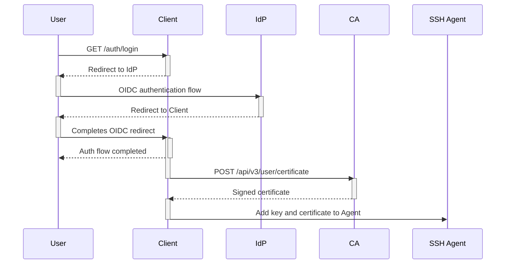
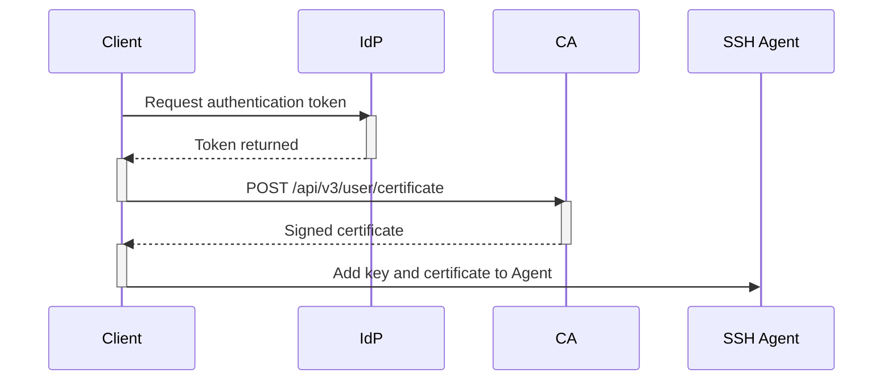
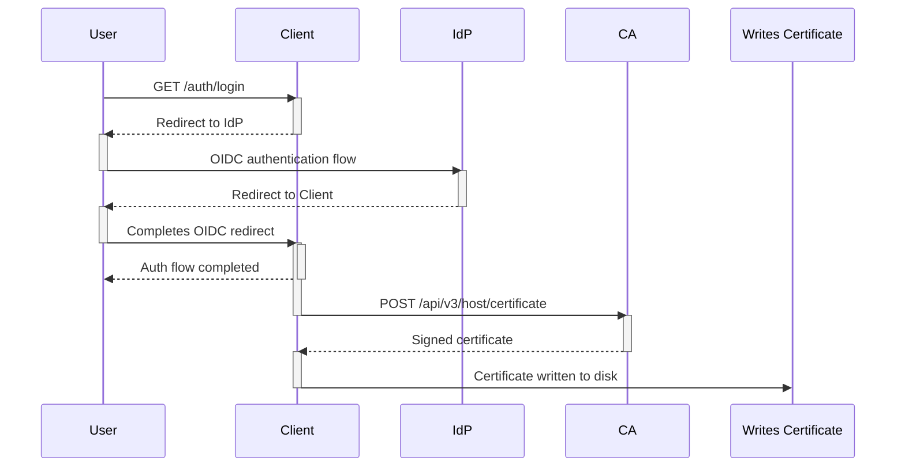
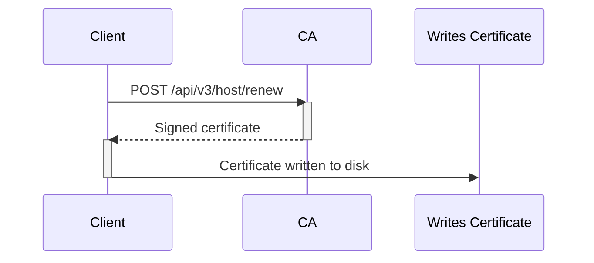
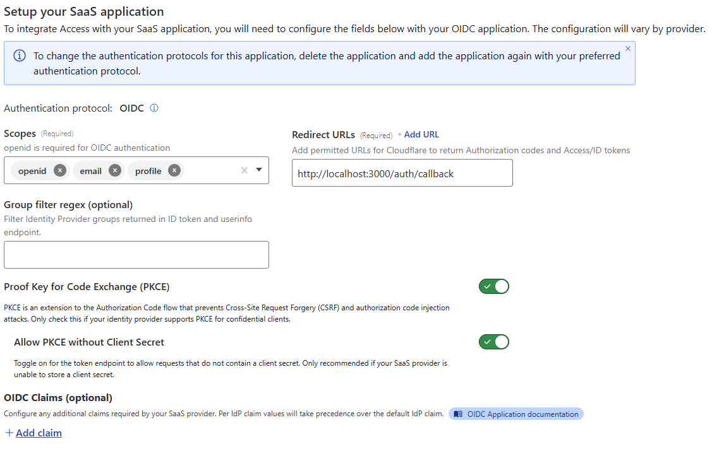
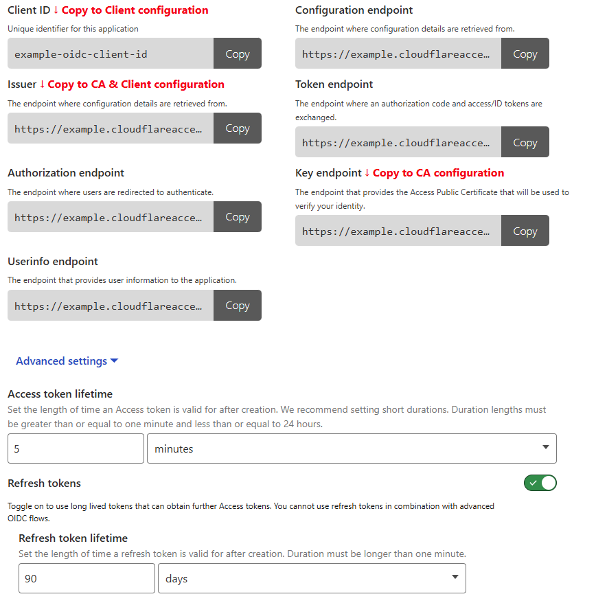

## @andrewheberle/serverless-ssh-ca

This is the package that implements the SSH CA functionality which can be deployed
to Cloudflare as a working solution using the "Deploy to Cloudflare" button below:

[](https://deploy.workers.cloudflare.com/?url=https%3A%2F%2Fgithub.com%2Fandrewheberle%2Fserverless-ssh-ca-template)

To use the package in your own Worker manually (assuming you have the requried
bindings in place), the following code in `src/index.ts` (your Worker's main
file) will work:

```ts
import app from "@andrewheberle/serverless-ssh-ca"

export default app
```

This package is built for Cloudflare Workers and can also run on Node.js 24
(see [Running on Node.js](#running-on-nodejs)). These are the only runtimes it
is tested on.

The package doesn't use any Workers-specific APIs and doesn't depend on
`@cloudflare/workers-types`. It needs:

- Web standard APIs (`Request`, `Response` and WebCrypto)
- Node.js compatibility (`nodejs_compat` on Workers), because `sshpk` uses Node APIs
- A database binding compatible with Cloudflare D1
- A secret binding with an async `get()` method that returns the CA private key

Its exported types describe only these needs, so the `Env` generated by
`wrangler types` (with `DB` as a `D1Database` and `PRIVATE_KEY` as a
`SecretsStoreSecret`) can be passed directly as `SshCaBindings`.

### Running on Node.js

Node.js 24 or later is required. Helpers for Node.js are imported from
`@andrewheberle/serverless-ssh-ca/node`:

| Helper | Purpose |
|---|---|
| `fromNodeSqlite(db)` | Uses a built-in `node:sqlite` database as the `DB` binding |
| `secretFromFile(path)` | Reads the CA private key from a file (re-read each time it is needed) |
| `secretFromString(value)` | Uses a string as the CA private key |
| `cacheInMemory()` | Uses an in-memory cache as the optional `CACHE` binding (see [KRL Caching](#krl-caching)) |
| `bindingsFromEnv({ DB, PRIVATE_KEY })` | Reads and validates the remaining configuration from `process.env` |

`createSshCa(bindings)` returns a `fetch(request)` handler that takes a
standard `Request` and returns a `Response`, and a `cleanup()` task that
replaces the Workers cron trigger.

The handler can be served by any server that works with `Request` and
`Response`. For example, with [`@hono/node-server`](https://www.npmjs.com/package/@hono/node-server)
(installed separately with `npm install @hono/node-server`):

```ts
import { DatabaseSync } from "node:sqlite"
import { serve } from "@hono/node-server"
import { createSshCa } from "@andrewheberle/serverless-ssh-ca"
import { bindingsFromEnv, fromNodeSqlite, secretFromFile } from "@andrewheberle/serverless-ssh-ca/node"

const ca = createSshCa(bindingsFromEnv({
    DB: fromNodeSqlite(new DatabaseSync("/var/lib/ssh-ca/ssh-ca.sqlite")),
    PRIVATE_KEY: secretFromFile("/etc/ssh-ca/ca_key"),
}))

// remove expired certificates once a day
setInterval(() => void ca.cleanup(), 24 * 60 * 60 * 1000)

serve({ fetch: (req) => ca.fetch(req), port: 8787 })
```

Notes:

- The configuration environment variables have the same names and formats
  as the `vars` in the Workers [`wrangler.jsonc`](https://github.com/andrewheberle/serverless-ssh-ca/blob/main/packages/workers-integration/wrangler.jsonc).
  `bindingsFromEnv` validates them at start up and throws an
  `InvalidConfigurationError` that lists every missing or invalid variable.
- The database schema is created and migrated automatically on first use, as
  on Workers. Use a file path for `DatabaseSync` (not `:memory:`) so issued
  and revoked certificates survive restarts.
- Only SQLite databases are supported. Other SQLite-compatible databases can
  be used by implementing the `CaDatabase` interface.
- The CA private key has the same requirements as on Workers (see
  [CA Private Key](#ca-private-key)). Keep the key file readable only by the
  user running the CA.
- `cleanup()` can also be run on a schedule outside the process (for example
  from a systemd timer or cron job) instead of using `setInterval`.
- Put the CA behind a reverse proxy that terminates TLS, as clients send
  identity tokens to it.

See the following respositories for additional information:


| Repostitory | Details |
|---|---|
| [https://github.com/andrewheberle/ssh-ca-client](https://github.com/andrewheberle/ssh-ca-client) | Contains client code for issuing user and host certificates |
| [https://github.com/andrewheberle/serverless-ssh-ca-template](https://github.com/andrewheberle/serverless-ssh-ca-template) | Contains a template repository for deployment to Cloudflare Workers |

## Architecture

The solution comprises of the CA running as a Worker, a Go based client
(found [here](https://github.com/andrewheberle/ssh-ca-client])) and a third
party OIDC IdP.

The IdP may be any OIDC compatible service that returns a JWT with at least
an `email` claim in the OIDC access token, however at this time only
Cloudflare Access has been tested.

### User Certificates

The flow to obtain a User SSH certificate using the CLI version is as follows:

1. The user initiates `ssh-ca-client-cli login`
2. If required a new SSH key is generated and the a browser is opened to
   visit `http://localhost:3000/auth/login`
3. The client redirects the user to the configured IdP
4. The IdP returns the user to the callback URL (default
   `http://localhost:3000/auth/callback`)
5. The client uses the JWT from the IdP as `Authorization: Bearer <TOKEN>`
   in a `POST` request containing the users SSH public key to the CA's
   `/api/v3/user/certificate` endpoint
6. The CA verifies the incoming JWT and assuming it is valid and verified, will
   respond with a signed certificate based on the provided public key
7. The client saves the certificate and adds the SSH private key and
   certificate to the local SSH Agent.

This flow is shown below once the user executes `ssh-ca-client-cli login`:



If a refresh token is available, the process looks like this when running
`ssh-ca-client-cli login`:



If the process to request a new authentication token fails using the refresh
token, the standard authentication process is followed which requires user
interaction.

### Host Certificates

#### Initial Request

The process to request an intitial Host certificate is similar to obtaining
a User certificate once `ssh-ca-client-cli host` is run, however instead of
adding the obtained certificate to a SSH Agent, it is written to
`<KEYPATH>-cert.pub` instead:



Host certificate principals may be IP addresses, bare host names or fully
qualified domain names. As OpenSSH matches the principals of a host
certificate as patterns, principals containing wildcard or pattern characters
(`*`, `?`, `!` or `,`), whitespace or control characters are refused, as a
principal such as `*` would make the certificate valid for every host.

#### Renewals

Renewals are done using the existing certificate and will succeed if:

1. The certificate is not expired
2. It was issued by the CA
3. The public key used to obtain the certificate is the same as the one
currently presented
4. It has not been revoked, or already renewed

The certificate that was renewed is revoked and added to the host KRL, so it
cannot be used to renew again. SSH clients that check the host KRL will no
longer accept it, so `sshd` must be reloaded to present the renewed
certificate once it has been written to disk.

This means the OIDC authentication flow is not required in this case as shown
below when `ssh-ca-client-cli host --renew` is run:



## API

The CA serves two versions of its API, which are documented in OpenAPI
format at `/docs` and in [openapi.json](openapi.json):

| Action                   | v3                              | v4                                              |
|--------------------------|---------------------------------|-------------------------------------------------|
| Get the CA public key    | `GET /api/v3/ca`                | `GET /api/v4/ca`                                |
| Request user certificate | `POST /api/v3/user/certificate` | `POST /api/v4/user/certificates`                |
| Revoke user certificate  | `POST /api/v3/user/revoke`      | `DELETE /api/v4/user/certificates/{serial}`     |
| Get user KRL             | `GET /api/v3/user/krl`          | `GET /api/v4/user/krl`                          |
| Request host certificate | `POST /api/v3/host/certificate` | `POST /api/v4/host/certificates`                |
| Renew host certificate   | `POST /api/v3/host/renew`       | `POST /api/v4/host/certificates/{serial}/renew` |
| Revoke host certificate  | `POST /api/v3/host/revoke`      | `DELETE /api/v4/host/certificates/{serial}`     |
| Get host KRL             | `GET /api/v3/host/krl`          | `GET /api/v4/host/krl`                          |

Certificates are issued for Ed25519, ECDSA and RSA keys. RSA keys must be at
least 2048 bits; a request for a smaller key is refused with a `400` error,
and a certificate for a smaller key cannot be renewed. Certificates for
smaller keys can still be revoked.

### Proof of Possession

Requests that use an SSH key prove possession of its private key by including
a proof of the form `${timestamp}.${fingerprint}.${signature}`, where
`timestamp` is the time in milliseconds since the Unix epoch, `fingerprint` is
the SHA256 fingerprint of the public key (for example
`SHA256:79mq0wtpQMTvS4+Of8VzLN0qmYWNUyTXYmqKwhEgSLs`) and `signature` is the
BASE64 encoded armored SSHSIG signature (as produced by `ssh-keygen -Y sign`)
of the signed data. The proof is rejected if the timestamp is outside of
`CERTIFICATE_REQUEST_TIME_SKEW_MAX` of the time on the CA.

In v3 the proof is sent as the `proof` property of the request body and the
signed data is `${timestamp}.${fingerprint}` using the
`proof-of-possession@com.github.serverless-ssh-ca.andrewheberle` namespace.
As this does not say which request the proof is for, a proof captured from one
request may be replayed against another endpoint while it is valid.

In v4 the proof is sent in the `Proof-Of-Possession` header and is bound to
the request it is made for. The signed data is
`${timestamp}.${fingerprint}.${METHOD} ${path}` using the
`request-proof-of-possession@com.github.serverless-ssh-ca.andrewheberle`
namespace, where `${METHOD} ${path}` is the request as documented in the
OpenAPI schema with any parameters filled in, for example:

```
1765696780805.SHA256:79mq0wtpQMTvS4+Of8VzLN0qmYWNUyTXYmqKwhEgSLs.DELETE /api/v4/user/certificates/12345678901234567890
```

Only `${timestamp}.${fingerprint}.${signature}` is sent, as the CA rebuilds
the request part from the request it receives. The path does not change if
the CA is served behind a proxy under another path, and serials in the path
are written in decimal without leading zeros.

In v4 the public key for a revocation or renewal is taken from the proof and
the certificate respectively, so it is not sent separately.

## Configuration

### CA Private Key

The CA private key is read from the `PRIVATE_KEY` Secrets Store binding and
must be an unencrypted Ed25519 or ECDSA (`nistp256`, `nistp384` or
`nistp521`) key in OpenSSH format, which is what `ssh-keygen` creates by
default:

```sh
ssh-keygen -t ed25519 -N "" -C "" -f ssh-ca
```

RSA CA keys are not supported. With an RSA CA key
configured, every request that uses the CA key (including `/api/v3/ca` and
the KRL endpoints) returns a `500` error, and the reason is logged:

```
CA key type rsa is not supported, the CA key must be Ed25519 or ECDSA
```

### Identity Provider

This example shows the configuration in Cloudflare Access, however other
OIDC IdP's should be generally equivalent:



The `Redirect URL` must match the configured value in the client.

Transfer the IdP settings as follows:



The `openid` and `email` scopes are required, with enabling of refresh tokens
(the `offline_access` scope) being optional, but recommended.

`JWT_AUD` must be set to the audience the IdP issues tokens for this
application with (for Cloudflare Access, the application's AUD tag). Both the
access token and the identity token must be issued for this audience, so
tokens the IdP issues for other applications are not accepted. If the IdP
issues access tokens with a different audience to identity tokens, set
`JWT_ACCESS_TOKEN_AUD` to the audience of the access token. Either value may
be a comma separated list. If `JWT_AUD` is not set, requests that need a
token fail with a `500` error.

The `email` claim of the access token must be an email address. It is used as
the key ID of user certificates, and with `SSH_CERTIFICATE_INCLUDE_SELF` its
local part (before the `@`) is added as a principal. If the IdP includes the
`email_verified` claim it must be `true`, so tokens for an address the IdP has
not verified are refused.

As the local part does not include the domain, `alice@example.com` and
`alice@example.net` are given the same principal with
`SSH_CERTIFICATE_INCLUDE_SELF`. Only enable it when the IdP only allows users
from domains you control.

### Rate Limiting

Requests to issue, renew and revoke certificates can be rate limited by
adding a [rate limit binding](https://developers.cloudflare.com/workers/runtime-apis/bindings/rate-limit/)
named `RATE_LIMITER` to `wrangler.jsonc`:

```jsonc
"ratelimits": [
	{
		"name": "RATE_LIMITER",
		"namespace_id": "1001",
		"simple": { "limit": 10, "period": 60 }
	}
]
```

Requests are counted by the client IP address in the `CF-Connecting-IP`
header, and requests over the limit receive a `429` response. Requests to get
the CA public key and the KRLs are not limited, as many hosts may fetch them
from the same address. When no `RATE_LIMITER` binding is configured, requests
are not limited. If the rate limiter fails, the request is allowed and the
error is logged, so certificates can still be issued and revoked.

On Node.js, pass any limiter with the same shape (a `limit({ key })` method
returning `{ success }`, see `CaRateLimiter`) as `RATE_LIMITER`, and choose
the key requests are counted by with the `rateLimitKey` option, as there is no
`CF-Connecting-IP` header:

```ts
const ca = createSshCa(bindingsFromEnv({
    DB: fromNodeSqlite(new DatabaseSync("/var/lib/ssh-ca/ssh-ca.sqlite")),
    PRIVATE_KEY: secretFromFile("/etc/ssh-ca/ca_key"),
    RATE_LIMITER: myLimiter,
}), {
    // the client address as set by your reverse proxy
    rateLimitKey: (req) => req.headers.get("X-Real-IP") ?? undefined,
})
```

Requests for which `rateLimitKey` returns `undefined` are not limited.

### KRL Caching

Generating and signing a KRL reads every revoked certificate from the
database, so the KRLs can be cached by adding an optional `CACHE` binding. On
Workers this is a KV namespace:

```jsonc
"kv_namespaces": [
    {
        "binding": "CACHE",
        "id": "<kv namespace id>"
    }
]
```

On Node.js an in-memory cache can be passed to `bindingsFromEnv`, or any
other cache that implements the `CaCache` interface:

```ts
const ca = createSshCa(bindingsFromEnv({
    DB: fromNodeSqlite(new DatabaseSync("/var/lib/ssh-ca/ssh-ca.sqlite")),
    PRIVATE_KEY: secretFromFile("/etc/ssh-ca/ca_key"),
    CACHE: cacheInMemory(),
}))
```

A cached KRL is never served after it is out of date. Each certificate type
has a revision in the database that is incremented whenever a certificate of
that type is revoked (including the previous certificate on a host
renewal), or when expired certificates are removed. The cache key includes
this revision and the fingerprint of the CA key, so a revocation or a new CA
key immediately uses a new key rather than relying on cache entries being
deleted or the cache being consistent. Entries are left to expire after 7
days.

A KRL keeps the same version and generation date until its contents
change, so a regenerated KRL is identical to the one that was cached. If the
cache cannot be read or written the KRL is generated as it is without a
cache.

### Client

Please visit the ssh-ca-client repository for further information:

https://github.com/andrewheberle/ssh-ca-client

### SSH Endpoints

#### Host Configuration

For systems to allow SSH login using certificates the following configuration
changes must be made:

```ssh
PubkeyAuthentication yes
TrustedUserCAKeys /etc/ssh/ca.pub
AuthorizedPrincipalsFile /etc/ssh/principals.d/%u
# Uncomment the following lines to enable host certificates
# HostCertificate /etc/ssh/ssh_host_rsa_key-cert.pub
# HostCertificate /etc/ssh/ssh_host_ecdsa_key-cert.pub
# HostCertificate /etc/ssh/ssh_host_ed25519_key-cert.pub
```

The contents of `/etc/ssh/ca.pub` is the public key of the SSH CA, which can be
retrieved as follows:

```sh
curl https://ssh-ca.example.com/api/v3/ca | sudo tee /etc/ssh/ca.pub
```

The `/etc/ssh/principals.d` directory should contain a file corresponding to
a local user that contains a list of principals that should be allowed
login.

Using the principals list in `SSH_CERTIFICATE_PRINCIPALS` above, the
following file named `/etc/ssh/principals.d/admin` would allow login
as the SSH user `admin` for the bearer of an issued (and valid) certificate:

```
ssh-admin
```

#### Client Configuration

In order for a client to trust a certificate presented by a host the following
configuration must be added to `/etc/ssh/ssh_known_hosts` (system wide) or
`~/.ssh/known_hosts` (user specific):

```
@cert-authority *.example.com ecdsa-sha2-nistp256 ....
```

The format of the above file is documented in the `ssh(1)` man page however
the important items of note is the `*.example.com` above tells `ssh` that the
CA public key (ie `ecdsa-sha2-nistp256 ....`) is trusted for all hosts, that
match `*.example.com`.

This will need adjusting depending on your environment along with the actual
SSH CA public key which can be retrieved as follows:

```sh
curl https://ssh-ca.example.com/api/v3/ca
```

Once the above configuration is completed and host certificates are in place
clients will not require "trust on first use" (TOFU) as the certificate will be
verified as being signed by the configured SSH CA.
